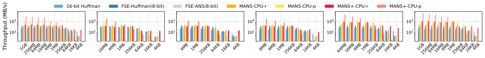
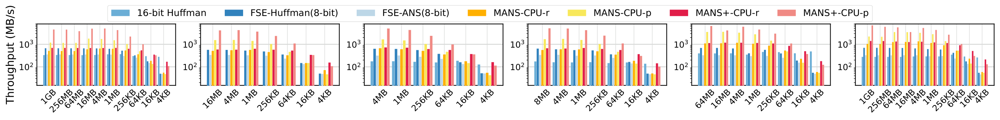
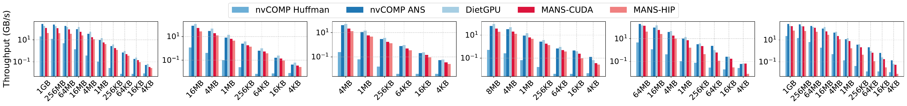
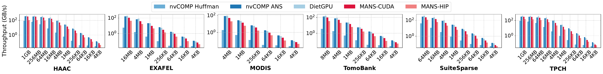
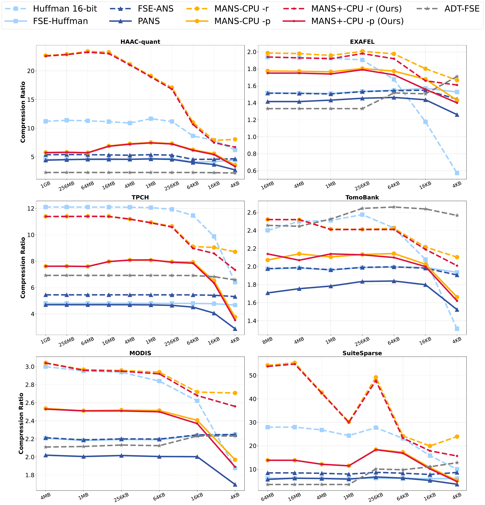

# 📦 PhotonZip

PhotonZip is a tensor-first Python wrapper around vendored lossless and
error-bounded lossy codecs for detector and tomography data, on the CPU and on
NVIDIA GPUs (CUDA).

> **Two versions in this repository**
>
> | Branch | For | Contents |
> |---|---|---|
> | `main` (this one) | CPU and NVIDIA GPUs | MANS on CPU/CUDA with autotune, LC, PFPL, HDF5 filters and delta preprocessing |
> | [`dcu`](https://github.com/hpdps-group/PhotonZip/tree/dcu) | Hygon DCUs (DTK / HIP) | LC and MANS on the DCU, DCU delta preprocessing, DCU HDF5 filters; validated on a Hygon BW (gfx936) |
>
> ```bash
> git clone https://github.com/hpdps-group/PhotonZip.git            # main: CPU / CUDA
> git clone -b dcu https://github.com/hpdps-group/PhotonZip.git     # dcu: Hygon DCU
> ```

| Codec | Data | CPU | CUDA | HDF5 filter |
|---|---|---|---|---|
| **MANS** (`codec="mans"`) | uint16/uint32, 1-3D | P- and R-mode, autotuned threads | P- and R-mode | `H5Z-MANS` (32032) |
| **LC** (`codec="lc"`) | uint16 | yes | - | `H5Z-LC` (32771) |
| **PFPL** (`codec="pfpl"`) | float32, lossy (relative error bound) | yes | - | `H5Z-PFPL` (32772) |

**MANS** ([hpdps-group/MANS](https://github.com/hpdps-group/MANS), ADM mapping + ANS)

- Exposed through `photonzip.compress(...)`, `photonzip.decompress(...)` and
  `photonzip.codec.mans.autotune(...)`.
- Streams carry their geometry; P-mode streams decode on the CPU and CUDA backends alike.

**LC** ([LC framework](https://github.com/burtscher/LC-framework) pipeline `DIFFMS_2 BIT_2 RZE_2`)

- Applied independently to 16 KiB chunks. Lossless, no tunable parameters, CPU (OpenMP).
- Bitstream compatible with the LC framework's standalone compressors.

**PFPL** ([PFPL](https://github.com/burtscher/PFPL) REL pipeline `QREL_4 DIFFNB_4 BIT_4 RZE_1`)

- Error-bounded lossy for float32: every sample is restored within `error_bound`
  of its own magnitude; samples at or above `threshold` are stored exactly.
- CPU only. The bitstream matches the standalone PFPL CPU compressor.

The lossless codecs can be combined with the optional global inter-slice delta
preprocessing (`photonzip.preprocess`).

The Python layer is DLPack-based; `compress(...)` and `decompress(...)` return
a `PhotonZipArray`, which converts to NumPy with `np.from_dlpack(...)`.

> **Status:** built on an RTX 5090 host (GCC 11, CUDA 12.8, HDF5 1.10.7) and in the NGC
> PyTorch 25.06 container (CUDA 12.9, PyTorch 2.8). `tests/python/test_codecs.py` passes
> (MANS CPU/CUDA, LC, PFPL), MANS P-mode streams decode across the CPU and CUDA backends,
> and the C++ and h5py HDF5 filter tests pass, except `test_lc_filter_declines_float32` on
> HDF5 1.10.7, which keeps a declined optional filter in the dataset's filter list (the
> chunks are stored raw and read back).

## Layout

```
3rdparty/lossless/lc/      LC framework components (host, header-only)
3rdparty/lossless/MANS/    MANS (CPU and CUDA backends, H5Z-MANS), vendored, see VENDORED.md
3rdparty/lossy/pfpl/       PFPL components (host, header-only)
src/photonzip/core/        codec registry, buffer types, DLPack header
src/photonzip/codecs/      MANS (CPU, CUDA), LC and PFPL codecs
src/photonzip/preprocess/  inter-slice delta (OpenMP)
bindings/python/           pybind11 extension module photonzip._native
python/photonzip/          Python package (API, codecs, preprocessing)
filters/                   HDF5 filter plugins H5Z-LC and H5Z-PFPL, C++ round-trip tests
examples/photonzip_cli.py  command-line tool with the .pzc container format
examples/MANS/             MANS examples (autotune, CPU/CUDA round trips, HDF5)
examples/hdf5/             H5Z-LC and H5Z-PFPL round trips with h5py
tests/python/              pytest suite (codecs on CPU/CUDA, HDF5 filters via h5py)
benchmarks/hdf5/           MPI/HDF5 filter benchmarks (tomography pipeline, PFPL REL sweep)
scripts/package_source.py  source-only ZIP of the repository
testdata/u2/               sample uint16 volumes (127^3)
```

## 🔧 Install

Requirements: a C++17 compiler with OpenMP, CMake >= 3.20, Python >= 3.9, NumPy,
and (for the HDF5 filters) the HDF5 C library with its high-level library, plus MPI
for the MANS HDF5 tools. MANS is vendored, so no submodules are needed.

```bash
git clone https://github.com/hpdps-group/PhotonZip.git
cd PhotonZip
python3 -m pip install .            # or: python3 -m pip install -e . --no-deps
```

Without HDF5 installed, skip the filter plugins:

```bash
python3 -m pip install . -Ccmake.define.PHOTONZIP_BUILD_HDF5_FILTERS=OFF
```

The CUDA path of MANS is built when CMake finds a CUDA compiler (put `nvcc` on `PATH`).
Force a platform with `-DPHOTONZIP_MANS_TARGET_PLATFORM=cpu` or `cpu_nv`;
`photonzip.available_backends()` lists what a build has. For the CUDA examples and
tests, use an environment with PyTorch, e.g.

```bash
conda create -n photonzip python=3.12 pytorch::pytorch pytorch::pytorch-cuda=12.1 -c pytorch -c conda-forge
conda activate photonzip
```

To build the native module and plugins with CMake only:

```bash
cmake -S . -B build -DCMAKE_BUILD_TYPE=Release -Dpybind11_DIR=$(python3 -m pybind11 --cmakedir)
cmake --build build -j
python3 -m pytest -q tests/python/test_codecs.py     # uses build/bindings/python
```

For the HDF5 filters, make sure h5py links the same `libhdf5` as the plugins
(e.g. `HDF5_DIR=... pip install --no-binary=h5py h5py`); two HDF5 copies in one
process break filter callbacks.

## 🧪 Usage

### CLI

```bash
# CPU, high throughput (LC)
python examples/photonzip_cli.py --mode compress \
  --input testdata/u2/sfc-gi/sfc-gi_127x127x127_4096kB.u2 --output /tmp/photonzip_cpu.pzc \
  --dims 127 127 127 --dtype uint16 --backend cpu --quality-level lossless --throughput-level high

# CPU, high compression ratio (MANS R-mode)
python examples/photonzip_cli.py --mode compress \
  --input testdata/u2/sfc-gi/sfc-gi_127x127x127_4096kB.u2 --output /tmp/photonzip_cpu.pzc \
  --dims 127 127 127 --dtype uint16 --backend cpu --quality-level lossless --ratio-level high

# decompress (shape, dtype, codec and preprocessing are read from the container)
python examples/photonzip_cli.py --mode decompress \
  --input /tmp/photonzip_cpu.pzc --output /tmp/photonzip_cpu_restored.u2 --backend cpu

# CUDA round trip (MANS on the GPU; needs PyTorch), with inter-slice delta
python examples/photonzip_cli.py --mode roundtrip \
  --input testdata/u2/sfc-gi/sfc-gi_127x127x127_4096kB.u2 --output /tmp/photonzip_cuda.pzc \
  --dims 127 127 127 --dtype uint16 --backend cuda --delta
```

The CLI prints throughput for the requested mode (`compress`: compression throughput
and ratio; `decompress`: decompression throughput; `roundtrip`: both, the ratio and an
equality check).

| Option | Values | Behaviour |
|---|---|---|
| `--quality-level` | `lossless` (default), `high`, `low` | only `lossless` is wired; `high`/`low` (error bound 1.0/8.0) are rejected |
| `--throughput-level` | `high`, `low` | `high` selects `lc` |
| `--ratio-level` | `high`, `low` | `high` selects MANS R-mode |
| `--codec` | `mans`, `lc` | forces a codec, overriding the levels; default `mans` |
| `--backend` | `cpu`, `cuda` | compress: `cpu` by default; decompress: the backend recorded in the file if the build has it, else `cpu`. LC runs on `cpu` only |
| `--no-warmup` | | include the one-time GPU start-up in the timings |
| `--delta` | | inter-slice delta before compression (uint16), see "Delta preprocessing" |
| `--delta-backend` | `cpu`, `numpy` | where `--delta` and its inverse run (default `cpu`); same bytes either way |

For MANS, the CLI reuses `build/best_threads.csv` if it exists; otherwise it runs
MANS autotune once and writes that CSV.

`--dims` is the C-order shape (slowest dimension first, 1 to 3 values). Legacy
aliases `--level`/`--fidelity`, `--speed` and `--ratio` are accepted. Invalid
arguments exit with status 2, runtime errors with status 1. `--delta` stores the
differences with the `offset` encoding for MANS and `int16` for LC.

Throughputs are raw bytes / time. `compress` and `decompress` time the codec
alone, including the copy of the compressed stream between GPU and host (with
`--backend cuda` the raw input is copied to the GPU before timing starts). With `--delta` the CLI also prints `delta` / `inverse_delta` (seconds)
and `compress_with_delta` / `decompress_with_delta`, which include them.

The `.pzc` container is `b"PZC1"`, a little-endian uint64 metadata length,
UTF-8 JSON metadata (`codec`, `backend`, `dtype`, `shape`, `codec_params`,
`preprocess`), then the codec payload.

More examples are in [`examples`](./examples) (MANS autotune, CPU/CUDA round trips,
HDF5).

### Python API

```python
import numpy as np
import photonzip
import photonzip.codec.mans as mans
from photonzip.preprocess import apply_delta, invert_delta

volume = np.fromfile("scan.u2", dtype=np.uint16).reshape(127, 127, 127)
photonzip.available_backends()        # ['cpu'] or ['cpu', 'cuda']

# MANS on the CPU with an autotuned thread table
table = mans.autotune(mans.MansAutotuneOptions()).thread_table
packed = photonzip.compress(volume, codec="mans", backend="cpu",
                            codec_options=mans.MansOptions(mode="r", thread_table=table))
restored = np.from_dlpack(photonzip.decompress(packed, backend="cpu"))
assert np.array_equal(restored, volume)

# MANS on CUDA (input on the host or as a CUDA tensor; the result stays on the GPU)
packed = photonzip.compress(volume, codec="mans", backend="cuda")
restored = photonzip.decompress(packed, backend="cuda")      # .to_host() copies it back

# LC, with inter-slice delta preprocessing (uint16 only)
delta, meta = apply_delta(volume)
packed = photonzip.compress(delta, codec="lc", backend="cpu")
restored = invert_delta(np.from_dlpack(photonzip.decompress(packed, backend="cpu")), meta)
assert meta["lossless"] and np.array_equal(restored, volume)

payload = packed.to_bytes()
```

PFPL compresses float32 within a relative error bound (CPU only):

```python
from photonzip.codec.pfpl import PfplOptions

x = np.asarray(..., dtype=np.float32)
packed = photonzip.compress(x, codec="pfpl", codec_options=PfplOptions(error_bound=1e-3))
restored = np.from_dlpack(photonzip.decompress(packed))
# |x - restored| <= ~error_bound * |x|; PfplOptions(threshold=t) keeps |x| >= t exact
```

`photonzip.compress(...)` defaults to `codec="mans"`. `MansOptions(mode="p"|"r")`
selects the MANS pipeline (default `"p"`); on the CPU the ADM thread counts come
from `adm_compress_thread`/`adm_decompress_thread`, a `thread_table`, a
`thread_csv_path` or `$MANS_THREAD_CSV`, else 32/32 with a one-time warning.

`PhotonZipArray.to_host()` copies an array (compressed or not) from GPU memory to
the host, `.device` says where it is (`"cpu"` or `"cuda"`), and `.reshape(shape)`
gives an uncompressed array another shape without a copy. Tensors that already
live on the GPU (PyTorch/CuPy, DLPack `kDLCUDA`) are compressed in place and the
results stay on the device.

To decompress raw payload bytes, rebuild the array with
`photonzip._native.compressed_from_bytes("lc", payload, "uint16", shape, "cpu")`
and pass it to `photonzip.decompress(...)`.

### Delta preprocessing

`apply_delta(array, encoding="int16", backend="auto")` stores slice 0 (along
axis 0) as-is and every following slice as `clip(x[i] - x[i-1], -32768, 32767)`
in a uint16 array. The result is lossless iff no difference overflows int16; the
returned metadata reports `overflow_pixels`, `lossless` and the `encoding`.
`invert_delta(array, meta)` restores the volume with a running sum modulo 2^16
(metadata without `encoding` means `int16`). `backend` is `cpu` (C++ with OpenMP
over the elements of a slice; also `auto`) or `numpy` (reference); both give the
same bytes. Input and output are in host memory.

| `encoding` | stored value | use with |
|---|---|---|
| `int16` (default) | two's complement bit pattern (-1 -> 65535) | LC |
| `offset` | difference + 32768 (-1 -> 32767) | MANS |

MANS needs `offset`: its ADM only maps blocks whose `max - min` is below 3500 and
codes `|value - center|`, so with `int16` any block holding both positive and
negative differences spans ~65535 and is stored raw. On a 100 x 2048 x 2048
tomography stack, `int16` left 2% of the blocks to ADM and MANS (ratio 1.254) did
worse than plain ANS on the same bytes (1.473); with `offset` 99.9% of the blocks
use ADM and MANS reaches 1.479. The CLI picks `offset` for MANS.

### MANS geometry

MANS indexes elements as `x + y*nx + z*nx*ny` (`nx` fastest). PhotonZip arrays and
HDF5 chunks are C-ordered, so the codec (on both backends), the HDF5 options from
`mans.to_hdf5_compression_opts` and the H5Z-MANS plugin pass the *last* dimension
as `nx` (`nx = shape[-1]`, `ny = shape[-2]`, `nz` = product of the remaining
dimensions). Passing `shape[0]` as `nx` (as earlier versions did) transposes the ADM tiles:
still lossless, but e.g. a 8x512x512 volume chunk drops from ratio 1.96 to 1.48 and
decompresses at half the speed. The geometry is stored in every MANS stream, so
streams written with either convention decode anywhere.

## HDF5 filters

Building PhotonZip also creates, under `build/bin/plugins/`:

- `libH5Z-MANS.so` (filter ID 32032)
- `libH5Z-LC.so` (filter ID 32771)
- `libH5Z-PFPL.so` (filter ID 32772)

Set `HDF5_PLUGIN_PATH=$PWD/build/bin/plugins` before importing `h5py`.
Round-trip examples are under `examples/hdf5/`; C++ and h5py correctness tests
are under `filters/test/` (`build/bin/filters/h5z_*_roundtrip`) and
`tests/python/test_hdf5_filters.py`. The MPI benchmark and the 32-rank PFPL REL
sweep are under `benchmarks/hdf5/` (their default data paths point at the RTX 5090
host they were run on).

`H5Z-LC` takes no `compression_opts`; the decoded size travels in the payload
header. It accepts uint16 datasets.

`H5Z-PFPL` accepts float32 datasets; its `compression_opts` come from
`photonzip.codec.pfpl.to_hdf5_compression_opts(PfplOptions(...))` (mode, error
bound and threshold as float bits).

`H5Z-MANS` accepts uint16/uint32 datasets and derives the ADM geometry from each
chunk (last chunk dimension as `nx`, see "MANS geometry"); it stores the geometry in
both the filter parameters and every compressed chunk. Compression does not cross
chunk boundaries; use the intended 3D volume as the chunk shape when cross-frame
correlation is required. Build its parameters with `mans.to_hdf5_compression_opts(...)`
(mode and autotuned threads).

```python
import h5py
import photonzip.codec.lc as lc
import photonzip.codec.mans as mans

with h5py.File("scan.h5", "w") as f:
    f.create_dataset("lc", data=volume, chunks=(16, 127, 127),
                     compression=lc.H5Z_FILTER_LC_ID)
    f.create_dataset("mans", data=volume, chunks=(16, 127, 127),
                     compression=mans.H5Z_FILTER_MANS_ID,
                     compression_opts=mans.to_hdf5_compression_opts(volume, chunks=(16, 127, 127)))
```

## 📊 Performance

### CPU Compression Throughput



### CPU Decompression Throughput



### NV Compression Throughput



### NV Decompression Throughput



### Compression Ratio



DCU results are in the README of the [`dcu`](https://github.com/hpdps-group/PhotonZip/tree/dcu) branch.

## LC payload format

```
int64          decoded size in bytes
uint16[n]      compressed size of each 16 KiB chunk (n = ceil(size / 16384))
bytes          concatenated chunk payloads
```

## 🧾 Citation

- [MANS](https://doi.org/10.1145/3712285.3759825)

## 🕰️ History

- `2026-10-24`: LC and PFPL REL codecs, HDF5 filters H5Z-LC/H5Z-PFPL with tests, delta preprocessing, HDF5 examples and MPI benchmarks; MANS vendored at hpdps-group/MANS 32793bc; DCU version on the `dcu` branch.
- `2026-04-12`: Add HDF5 Python support for MANS.
- `2026-04-03`: Integrated MANS CPU and GPU paths into the tensor-first Python framework.

## License

BSD 3-Clause (see `LICENSE`). The vendored components under `3rdparty/` carry
their own notices (`3rdparty/lossless/lc` and `3rdparty/lossy/pfpl`: BSD 3-Clause;
`3rdparty/lossless/MANS`: see its `LICENSE`).
